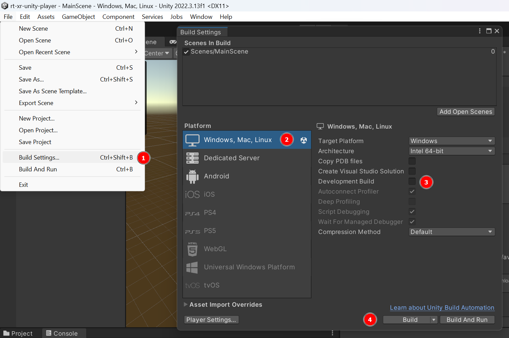

<p align="center">
  
</p>

<p align="center">
  An interactive, XR-capable glTF scene viewer built in Unity, supporting the glTF extensions of
  MPEG-I Scene Description (ISO/IEC 23090-14).
</p>

<p align="center">
  
  <a href="https://github.com/5G-MAG/rt-xr-unity-player/releases"></a>
  <a href="LICENSE"></a>
</p>

<p align="center">
  <a href="https://www.5g-mag.com/reference-tools/xr/">Project page</a> &nbsp;&middot;&nbsp;
  <a href="docs/xr-scene-player.md">Documentation</a> &nbsp;&middot;&nbsp;
  <a href="https://github.com/5G-MAG/rt-xr-unity-player/issues">Issues</a> &nbsp;&middot;&nbsp;
  <a href="https://www.5g-mag.com/contributing">Contributing</a>
</p>

---

## At a glance

|  |  |
|---|---|
| **Implements** | glTF extensions of MPEG-I Scene Description, [ISO/IEC 23090-14](https://www.iso.org/standard/86439.html) (the repository does not state an edition) |
| **Part of** | [XR/3D Scenes with MPEG-I Scene Description](https://www.5g-mag.com/reference-tools/xr/), alongside [rt-xr-gITFast](https://github.com/5G-MAG/rt-xr-gITFast), [rt-xr-maf-native](https://github.com/5G-MAG/rt-xr-maf-native), [rt-xr-content](https://github.com/5G-MAG/rt-xr-content) and [rt-xr-blender-exporter](https://github.com/5G-MAG/rt-xr-blender-exporter) |

## Introduction

The XR Unity Player is an interactive and XR-capable glTF scene viewer implemented in Unity3D. It supports glTF extensions specified in the MPEG-I Scene Description framework ([ISO/IEC 23090-14](https://www.iso.org/standard/86439.html)). These extensions support features such as video textures, spatial audio sources, interactivity behaviors, XR anchors,...

The project has dependencies integrated as [Unity embedded packages](https://docs.unity3d.com/Manual/upm-embed.html).

- **rt-xr-glTFast** : This package supports MPEG-I glTF extensions, it is installed as a git submodule : [github.com/5G-MAG/rt-xr-maf-native](https://github.com/5G-MAG/rt-xr-maf-native)
- **rt-xr-maf-native**: Supports media pipeline plugins, see the package's [README](./Packages/rt.xr.maf/README.md) for details. It must be compiled and installed manually : [github.com/5G-MAG/rt-xr-maf-native](https://github.com/5G-MAG/rt-xr-maf-native)


Additional information can be found at: https://5g-mag.github.io/Getting-Started/pages/xr-media-integration-in-5g/


## Clone the Unity project

When cloning the project, use the *--recursive* flag to pull *rt-xr-glTFast*.
```
git clone --recursive https://github.com/5G-MAG/rt-xr-unity-player.git
```

> [!NOTE]
> When pulling changes, submodules aren't updated by default. This has to be explicitly requested, eg. using: `git pull --recurse-submodules`


## Build the project and install it on an Android device


### Supported platforms

While the project is currently primarly developed for and tested on Android devices, it can be compiled on Windows, Mac OS, and Linux. 

**By default, the project is compiled for Android 9.0 (API Level 28), targeting arm64 architexture.**

This can be changed in Unity's *"Player settings"* panel, under the *"Settings for Android"* tab, in the *"Other settings"* section.

Mobile XR scenarios using the *MPEG_anchor* glTF extension are supported on **Android** through the [Google ARCore](https://docs.unity3d.com/Packages/com.unity.xr.arcore@5.1/manual/index.html) plugin. When you enable the Google ARCore XR Plug-in in Project Settings > XR Plug-in Management, Unity automatically installs this package if necessary.  Google maintains a [list of compatible XR devices](https://developers.google.com/ar/devices?hl=fr).


#### Spatial audio support

Support for audio spatialization requires the installation of an audio spatializer plugin. 
When an audio plugin is not installed, audio play but will not be spatialized.

See the related [documentation](./docs/audio-spatializer.md)


### Compiling *rt-xr-maf-native*

**Android**

The easiest way is to compile the media pipeline plugins is by using the Dockerfile: 
```
git clone git@github.com:5G-MAG/rt-xr-maf-native.git
cd rt-xr-maf-native
docker build -t rtxrmaf:builder .
```

Then install the build artifacts into the unity project's `Package/rt.xr.maf` directory:
```
cd rt-xr-unity-player
docker run --mount=type=bind,source=$(pwd)/Packages/rt.xr.maf,target=/install -it maf:builder
```

If you are building the container on an ARM host (eg. Snapdragon X Elite, Apple silicon), use [podman](https://podman.io/) instead of docker with the [--arch](https://docs.podman.io/en/latest/markdown/podman-run.1.html#arch-arch) option: 
```
podman build -t rtxrmaf:builder .
podman run --arch=amd64 --mount=type=bind,source=$(pwd)/Packages/rt.xr.maf,target=/install -it maf:builder
```

**Building the player for other platforms:**

Refer to the [git repository](https://github.com/5G-MAG/rt-xr-maf-native) for more informations on the build process.
Configure the Unity project for your target platform. Most features are implemented with Unity's framework, and as such are XR runtime agnostic.


### Building and running the Unity project



1. Locate the `Build Settings` menu
2. Make sure that Android is the selected platform, change as needed.
3. Check that Mobile XR is the default scene
4. Select the device on which the application will be installed
5. Build & Run


## Upload content to an Android device & configure the player

This section assumes adb is installed on the machine, and Android smartphone is connected, with *developer mode* enabled on the phone.

Clone the `rt-xr-content` repository:
```
git clone https://github.com/5G-MAG/rt-xr-content.git
```

Push glTF content to the phone:
```
cd rt-xr-content
adb push ./awards /storage/emulated/0/Android/data/com.fivegmag.rtxrplayer/files/awards
```

Create a file named *'Paths'* listing gltf documents to be exposed in the player, one per line (see an example for awards.gltf):
```
/storage/emulated/0/Android/data/com.fivegmag.rtxrplayer/files/awards/awards.gltf
```

Upload the *'Paths'* file to the Android device:
```
adb push ./Paths /storage/emulated/0/Android/data/com.fivegmag.rtxrplayer/files/Paths
```

## License

This project is developed under 5G-MAG's Public License. For the full license terms, please see the LICENSE file distributed along with the repository or retrieve it from [here](https://drive.google.com/file/d/1cinCiA778IErENZ3JN52VFW-1ffHpx7Z/view).
