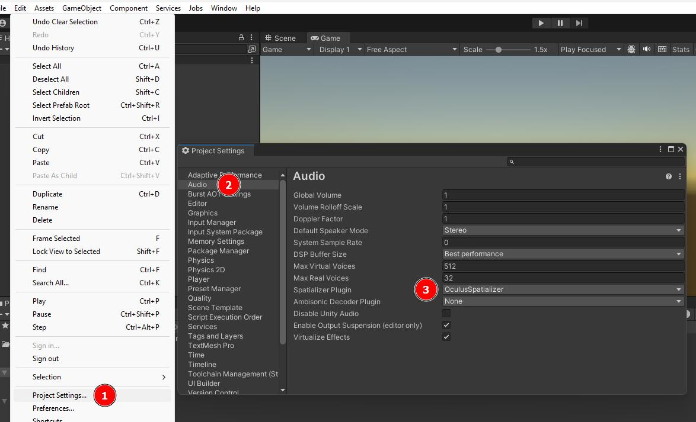

### Configure an Audio spatializer SDK

Spatial audio sources are rendered by an audio spatializer SDK. The SDK is not part of this repository: it must be installed in the Unity project, and selected in the project settings *Edit > Project Settings > Audio > Spatializer Plugin*.

**If no audio spatializer plugin is configured, audio will play without spatialization**.

#### Steam Audio

The project settings select Steam Audio: *Spatializer Plugin* is `Steam Audio Spatializer` and *Ambisonic Decoder Plugin* is `Steam Audio Ambisonic Decoder`. Steam Audio is released under the Apache-2.0 licence. It was tested here with Steam Audio 4.8.1 and Unity 6000.0.25f1, on Android (arm64).

1. Download `steamaudio_unity_<version>.zip` from the [Steam Audio releases](https://github.com/ValveSoftware/steam-audio/releases) and extract it.
2. In Unity, choose *Assets > Import Package > Custom Package*, select `steamaudio_unity/unity/SteamAudio.unitypackage` and import everything. The plugin is installed in `Assets/Plugins/SteamAudio/`, which Git ignores.
3. Open the project in the Unity editor once after the import. Steam Audio then creates `Assets/Plugins/SteamAudio/Resources/SteamAudioSettings.asset`. Importing the package in batch mode does not create it, and without it the player fails at start with a `NullReferenceException` in `SteamAudioManager.OnApplicationStart`.
4. Check that *Project Settings > Audio* shows the two Steam Audio plugins.

The steps of Steam Audio itself are in `steamaudio_unity/doc/getting-started.html`, inside the zip.

#### Oculus Spatializer Plugin

Do not use the Oculus Spatializer Plugin. Meta states: "The Oculus Spatializer Plugin has been replaced by the Meta XR Audio SDK and is now in end-of-life stage." See the [Meta documentation](https://developers.meta.com/vr/documentation/unity/audio-osp-unity-req-setup/).

#### Other plugins

Please refer to Unity's [documentation for details and a list of available plugins](https://docs.unity3d.com/Manual/VRAudioSpatializer.html).

Unity provides a native audio spatializer SDK with a [simple spatializer implementation](https://docs.unity3d.com/Manual/AudioSpatializerSDK.html).
